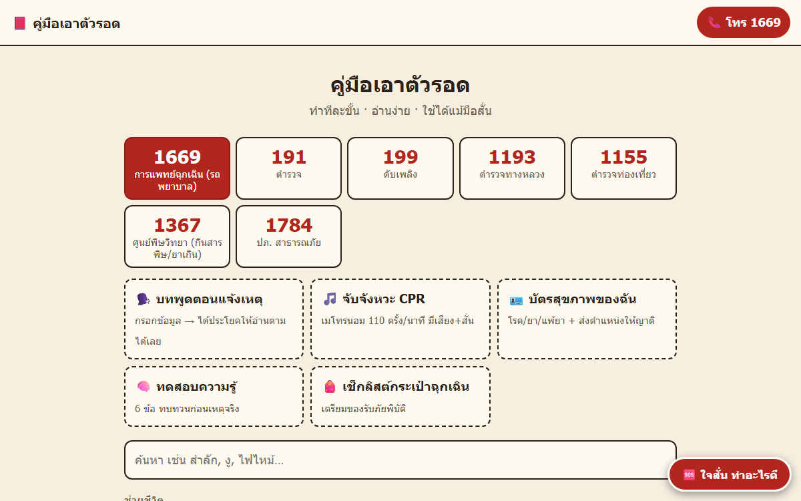

# 🚑 Thai Emergency Guide — คู่มือเอาตัวรอด

A mobile-first, offline-ready web app that walks a bystander through an emergency **one step at a time**, in Thai.



**▶ Live demo:** https://pear1790.github.io/thai-emergency-guide/

## Features
- **17 first-aid chapters** — CPR, choking, severe bleeding, burns, stroke (BE-FAST), heart attack, drowning, heatstroke, snakebite, seizure, anaphylaxis, poisoning, road accidents, building fire, earthquake, flood, fainting
- **CPR mode** with a 100–120 bpm metronome to keep compressions on pace
- **Call script** — what to say when calling 1669, with your current location filled in (browser geolocation + OpenStreetMap reverse geocoding) and a Google Maps link to share
- **Panic button** with a guided breathing exercise
- **One-tap emergency numbers** — 1669, 191, 199, 1193, 1155, 1367, 1784
- **Medical profile, quiz, and go-bag checklist**, saved on the device
- **Works offline** as an installable PWA (service worker + web manifest)

## Tech
Vanilla HTML, CSS, and JavaScript · PWA (Service Worker, Web App Manifest) · Geolocation API · localStorage — no build step, no dependencies.

## Run locally
```bash
python -m http.server 5101
```
Then open http://localhost:5101. All guide content lives in `data.js`.

> ⚠️ The guidance follows general first-aid recommendations (Thai Red Cross / AHA / ERC). It should be reviewed by a medical professional before real-world use and does not replace professional care.
